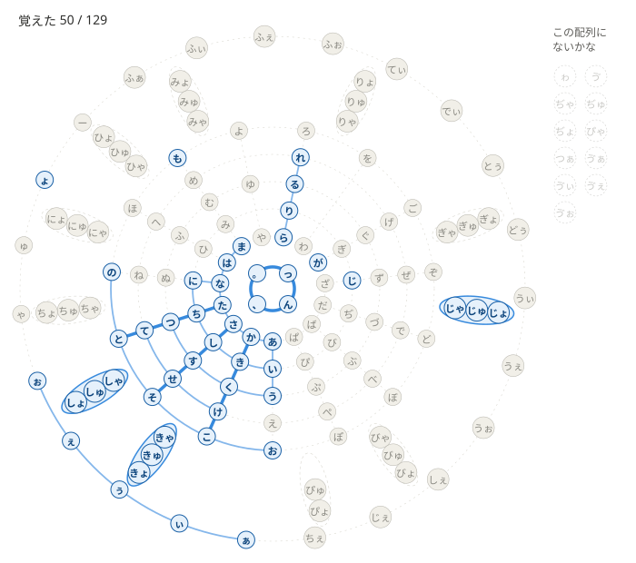

# キー配列習得

新しいキー配列（主にかな配列）の割り当てを覚えるための練習モード。**まだ作っていない（仕様を考えている途中）。** ここには、これまでに決まったことと、まだ決まっていないことを書く。練習モードに共通の決まりは `docs/practice.md`。

## 目的

- 割り当て表のかなを、1つずつ「覚えた」かどうかで見て、どこまで覚えたか（習得度）と、まだ残っているものが分かるようにする。
- 達成項目をいくつか作り、割り当てを全部覚えたら、達成項目も全部そろう、という難しさにする（速さの項目は入れない。速さはふだんのモードのレベルで見る）。
- 達成項目には**ゲームらしさ**を取り入れ、達成できたときに少し気分が上がるようにする（何をどう見せるかは「まだ決まっていないこと」）。

## 決まったこと

### 呼び方

- このモードは「キー配列習得」と呼ぶ（「練習」はほかの練習モードと紛らわしいため）。

### 覚えたかどうか

- 覚える単位ごとに、**正確率 95% 以上**で打てたら「覚えた」とする（レベルの達成と同じ基準。`docs/levels.md`）。
- **数えるセッション**：その配列で打った、キー配列習得の回だけ（ほかのモードの回は入れない）。
- **数える範囲**：その単位が出てきた回数が、直近の **20 回**以上になるところまで、新しいセッション（1回分の記録）から順にさかのぼり、そのセッションに出てきた全部の回で正確率を出す。セッションの途中では区切らない。
  - 例：直近のセッションから3回分さかのぼったところで、その単位が合わせて 35 回出てきたなら、その 35 回の正確率で判定する。
  - 全部のセッションを合わせても 20 回に届かない単位は、まだ判定しない（「覚えた」にならない）。
- **1回の正誤**：その単位を打つ間に、間違えたキーが1つもなければ「正しく打った」、1つでもあれば「間違えた」とする（直して打ち直しても、間違えたキーがあれば間違い）。正確率 ＝ 正しく打った回数 ÷ 出てきた回数。
- **手引きは出さない**：押すキーを画面に見せることはしない（割り当てを思い出して打つことを練習するため）。
- **忘れたとき**：一度「覚えた」になっても、その後のセッションを入れて同じように数えた正確率が 95% を下回ったら、忘れたものとみなし、もう一度覚える対象にする。

### 覚える単位

- 割り当て表で、1文字を出す行（例：`j` →「の」）を1つの単位とする。シフト面の行も同じ。
- 拗音・外来語の組（「きゃ」「ふぁ」など）は、**割り当て表にその組の行があれば**、それを1つの単位とする。なければ、それぞれの文字（「き」と「ゃ」）を単位とする。
- 割り当て表にある、いくつものかなを続けて出す行（例：「かぶぶ」）は、ほかの行の組み合わせで打てるので、単位にしない。

### 進め方（2つの段階）

1. **基本30字**：日本語の文章でよく使う30文字（基本30字）を覚える。どの配列でも同じ進め方・同じお題の単語リスト（下の A）を使う。
   - 基本30字（よく使う順）：い・ん・う・の・か・た・と・し・、・く・に・て・る・は・な・こ・が・っ・き・。・で・す・つ・あ・ら・ま・を・さ・り・も
   - よく使う文字ほど、たいていの配列でシフトなしの面（ホーム行など）に置かれているので、配列によらない文字から始めても、配列の大事なところから覚えられる。
   - **最初の8字**：初めに、い・ん・う・の・か・た・と・し の8字を覚える。8字を全部覚えるまでは、この8字だけでできた言葉だけを出す。
   - **2字ずつ足す**：8字を覚えたら、残りの22字からランダムに2字を選んで足し、覚えた字とその2字でできた言葉を出す。足した字のうち覚えたものがあれば、次のセッションで、その代わりに残りからランダムに別の字を足す（覚えていない新しい字が、いつも2字あるようにする。残りが1字になったら1字）。基本30字を全部覚えるまで繰り返す。
   - 最短（間違いなく、足した字を毎回そのセッションで覚えたとき）で、最初の8字に1回・残りの22字に11回の、合わせて 12 セッション。
2. **配列ごとのまとまり**：基本30字を覚えたら、配列の割り当て表から作ったまとまりを、1つずつ覚える。
   - シフトなしの面は、ホーム行 → 上の行 → 下の行 → 数字キーの行の順に分ける。
   - シフトキーがいくつもある配列（前置・後置シフトのキーが2つ以上）は、シフトキーごとに分け、シフト面1・シフト面2 … とする。
   - シフトキーが1つの配列は、そのシフト面を、ホーム行・上の行・下の行・数字キーの行に分ける。
   - 各まとまりでは、まだ覚えていない単位だけを練習する。全部覚えていれば、そのまとまりは飛ばす。

### お題

- 意味のない文字の並びは使わず、**2〜5文字の言葉**を打つ（読みのかなで数える。拗音の「きゃ」なども2文字と数える）。単語リスト A・B の言葉も、この長さにする。
- 基本30字の段階：単語リスト A の言葉。1回のお題は約300文字（スペースを含む。約77語）で、次のように組む。
  - **新しい字を含む言葉**：新しい字（覚えていない足した字）1字ごとに **20 語**（1語にその字が1回ほど入るので、1回のセッションでその字が20回ほど出てきて、「覚えた」かどうかを判定できる）。新しい字が2字なら 40 語。
  - **残り**（新しい字が2字なら約37語）：すでに覚えた字だけでできた言葉（確かめる分）。
  - 1回のお題には、ちがう言葉を出す（同じ言葉を重ねない）。単語リストで言葉が足りないときだけ、同じ言葉を2〜3回まで出してよい。
  - 最初の8字の段階は、全部をこの8字だけでできた言葉にする。
- 配列ごとのまとまりの段階：覚えた文字 ＋ そのまとまりの単位だけでできた言葉（単語集 B）。
- 「、」「。」「を」は言葉に入らないので、「ほんを よむ。」「はい、」のような**短い言い回し**で練習する。

### 単語リスト（これから作る）

- **A. 基本30字の単語リスト**
  - 今の日本語の単語リスト（`wordlists/ja/basic1000.txt`）とは別に作る（同じ言葉が入ってもよい）。
  - 足す字はランダムに選ぶので、どの順で足しても言葉がそろうように、次の言葉を用意する。
    - 最初の8字だけでできた言葉。
    - 残りの22字それぞれについて、「最初の8字 ＋ その1字」だけでできていて、その字を含む言葉を **20 語**（1回のお題の20語を、ちがう言葉で埋められるように）。見つからない字は少なくてもよい（そのときは、お題で同じ言葉を2〜3回まで出す。7 語以上はほしい）。これがあれば、どの2字を足しても、新しい字を含む言葉が出せる（覚えた字が増えた後も使える）。
    - 覚えた字が増えた後に、種類を増やすための、基本30字のいろいろな組み合わせでできた言葉。
  - 「、」「。」「を」は、最初の8字の言葉をつないだ短い言い回し（「たかい、」「いう。」など）で用意する。
- **B. 基本30字 ＋ ほかの単位の単語集**（600〜800 語の見込み）
  - どの配列でも足りるように、言葉は「基本30字 ＋ 覚える単位1つ」だけでできたものにし、どの単位にも5語以上そろえる。
  - 対象の単位：基本30字以外の文字（清音・濁音・半濁音の残り、小書き、ゎ・ゔ・ー）、拗音の組（33）、外来語の組（ふぁ・てぃ など）。
  - 言葉が見つかりにくい単位（ゔ・ぢ・ゎ・ぁぃぅぇぉ など）は、外来語を使うか、その単位だけ「基本30字以外の文字を2つまで」にゆるめる。
- どちらも単語モードには出さない。
- 新しい配列を試すときは、割り当て表の単位ごとに言葉が何語あるかを数え、5語に届かない単位を知らせて、言葉を足す。

### 記録・表示

- 練習モードとして記録する（`practice: true`。`docs/practice.md`）。
- 習得度と達成項目の一覧は、記録のページに出す。覚えたかなは、下の「覚えたかなの図」で見せる（そのほかの出し方は「まだ決まっていないこと」）。

### 覚えたかなの図

シフト面などがあるキー配列の図では全部を一度に見られないので、かなを曼荼羅のような図に並べ、覚えたかなを色で見せる。並びがそろうと線や円がつながり、全部覚えると1つの模様になる。

（例：基本30字を決める前に、仮の30字（い う ん る し か く き た と す つ ま ょ じ て に な こ の ち あ っ ら は り も が れ お）と、け・せ・そ・さ・、・。・ぁぃぅぇぉ、拗音の き・し・じ の組を覚えたところとして作ったもの。右の「この配列にないかな」は、例のために決めたもの。図を描くコードは `js/kana-mandala.js`（まだどのページからも使っていない）。か行・さ行・た行は全部覚えたので太い線、き・し・じ の花びらは塗られている。中心の4つもそろっている）

- **放射線（行）**：中心から外へ、各行のかなを あ・い・う・え・お の段の順に一直線に並べる。あ行（「あいうえお」）は中心から真下に向け、ほかの行は同じ角度ずつ回して並べる。行は あ・か・さ・た・な・は・ま・や・ら・わ・が・ざ・だ・ば・ぱ の 15 本（濁音・半濁音も、清音と同じく1本ずつ）。
  - や行は や・ゆ・よ、わ行は わ・を だけで、かなのない位置（い・え など）は空けておく。
- **同心円（段）**：同じ段のかなは、同じ円の上に並ぶ。内側から あ段（「あかさたな…」）・い段・う段・え段・お段。
- **花びら（拗音）**：割り当て表に拗音の組（「きゃ」など）がある配列では、その行の放射線と次の放射線の間に、外向きの花びらを置き、中に内側から ゃ・ゅ・ょ の組を並べる（き・し・ち・に・ひ・み・り・ぎ・じ・ぢ・び・ぴ）。その行の拗音の組が割り当て表に1つもなければ、花びらも描かない。
- **中心**：「ん」「、」「。」「っ」を、中心の小さな輪に並べる。
- **一番外の輪**：小書き（ぁ・ぃ・ぅ・ぇ・ぉ・ゃ・ゅ・ょ・ゎ）、「ゔ」、「ー」、外来語の組（ふぁ・てぃ・うぇ など。割り当て表に1行としてあるものだけ）を並べる。小書きの ゃ・ゅ・ょ は、拗音の組がない配列（き＋ゃ と分けて打つ配列）で、覚える単位になる。
- **色**：覚えたかなは青、まだのかなは薄い灰色。
- **線**：隣り合う2つのかな（放射線の上・円の上・花びらの中・中心の輪・一番外の輪）を両方覚えると、間を薄い青の線でつなぐ。その並び（行・段・花びら・中心・一番外の輪）を全部覚えると、太い濃い青の線にする（花びらは中を薄い青で塗る）。全部覚えると、15 本の放射線・5 つの円・全部の花びら・中心と外の輪がつながった模様になる。
- **この配列にないかな**：割り当て表にないかなは図に出さず、図の右に薄い点線の丸で並べ、「この配列にないかな」と書く。図の中のその位置は飛ばしてつなぐので、ないかながあっても、線・円・花びらは最後までそろえられる。
- **数**：図の上に「覚えた 41 / 129」のように、覚えた単位の数と、その配列の単位の数だけを出す（そろった線・円などの数は出さない）。
- 覚えた・まだは、記録から「覚えたかどうか」の決まりで求めて見せるだけで、手で変えることはできない。

## まだ決まっていないこと

- **習得度の数え方**：単位の数で数えるか、よく使う文字ほど重くするか。
- **練習の進め方の細部**：最初の8字だけでできた言葉を何語用意するか（最初の段階は、約77語を全部この言葉で埋める）。配列ごとのまとまりの段階で、1回のお題をどう組むか（基本30字の段階と同じく、新しい単位1つごとに20語にするか）。
- **達成項目**：何を達成項目にするか（例：基本30字、配列ごとのまとまりごと、全部）。全部覚えたら全部そろうようにする。ゲームらしさをどう取り入れるか（名前・達成したときの見せ方など）も、あとで考え直す。
- **記録のページでの出し方の残り**：覚えたかなの図のほかに何を出すか（習得度・達成項目・配列図での色分けなど）、図のかなにマウスを乗せたときに正確率や回数を出すか。
- **対象の配列**：かな配列のほかに、英語の配列（Dvorak など）も対象にするか。
- **英語の配列での覚えたかなの図の見せ方**：英語の配列も対象にするとき、覚えた文字（英字・記号）をどんな図で見せるか（かなの曼荼羅は、行と段がある、かなの並びに合わせた形のため）。
- **`mode` の値**、記録の形に足すもの（`docs/storage.md`）。
- **短い言い回しの長さ**：「、」「。」「を」を練習する言い回し（例：「ほんを よむ。」）も2〜5文字にするか。言葉どうしをつなぐので、長くなりやすい。
